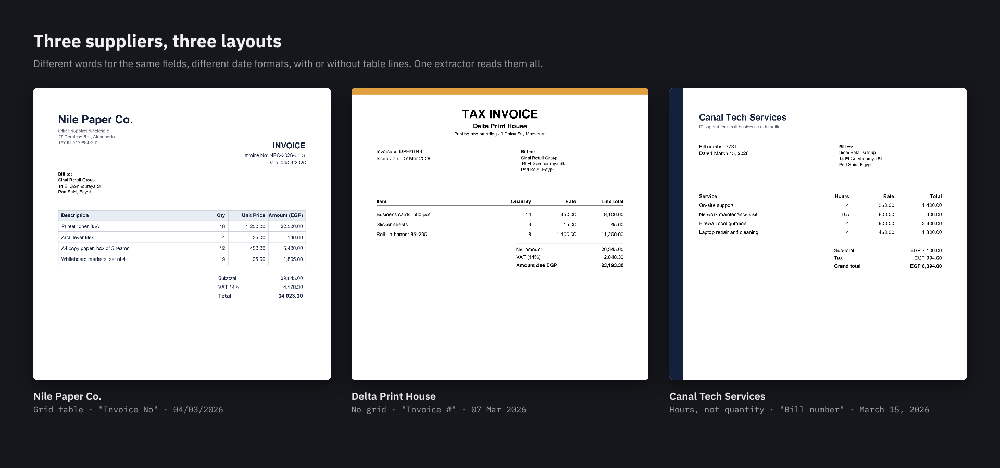
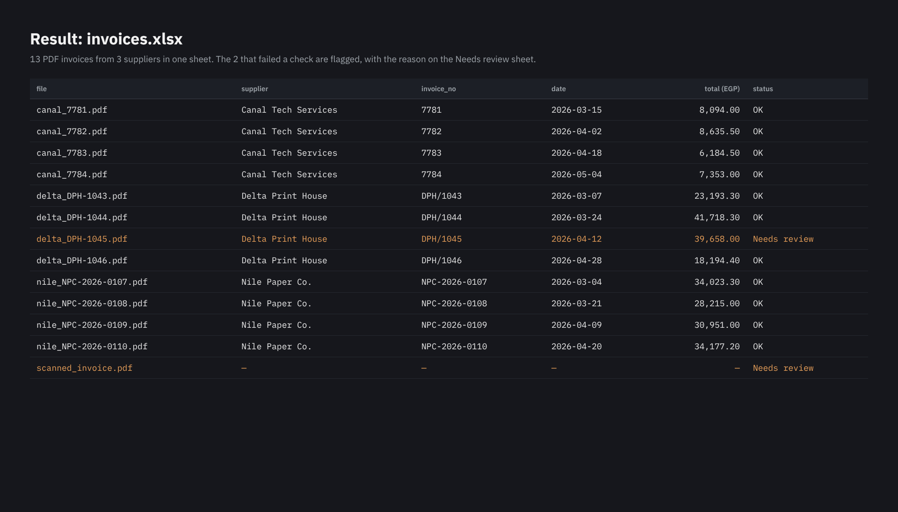

# PDF Invoice Extractor

[](../../actions/workflows/tests.yml)

Reads a folder of PDF invoices from different suppliers, each with its own layout, into one Excel workbook,
and checks that every invoice adds up.



## The problem

Accounts teams still type supplier invoices into Excel by hand. Every supplier uses its own layout and its own
words for the same thing: "Invoice No", "Invoice #" or "Bill number"; "Subtotal", "Net amount" or "Sub-total";
dates written as `04/03/2026`, `07 Mar 2026` or `March 15, 2026`. Typing them is slow, and one wrong total goes
straight into the books.

## What it does

| Step | What happens |
|---|---|
| Read | Supplier, invoice number, date, every line item, subtotal, VAT and total, from any of the layouts |
| Check | Quantity × unit price = line amount; the lines add up to the subtotal; subtotal + VAT = total |
| Flag | Scans with no text layer, and invoices that don't add up, go to a **Needs review** sheet with the reason |
| Write | `invoices.xlsx` with **Invoices**, **Line items** and **Needs review** sheets, with filters, frozen headers and number formats |

Nothing is guessed. If an invoice fails a check it is still extracted, and flagged, so you only look at the ones
that need a human.

## Run it

```bash
pip install -r requirements.txt
python make_sample_invoices.py      # creates data/invoices/ with 13 sample invoices
python extract.py data/invoices     # writes output/invoices.xlsx
```

To read your own invoices: `python extract.py path/to/invoices --out results`.


## Result on the sample invoices

13 invoices in, 49 line items out. 11 invoices passed every check, and 2 were flagged:

- **DPH/1045:** "Subtotal + VAT = 39,558.00, but the total says 39,658.00 (+100.00)". The supplier's total was
  100 EGP too high, and the check caught it.
- **scanned_invoice.pdf:** "No text layer (scanned image): needs OCR or manual entry".



The full workbook is in [`output/invoices.xlsx`](output/invoices.xlsx). The sample suppliers are fictional and the
invoices are generated by `make_sample_invoices.py`.

## Adapting it to your invoices

The words it looks for are listed at the top of [`extract.py`](extract.py): `INVOICE_NUMBER`, `DATE_PATTERNS` and
`TOTAL_LABELS`. Adding a new supplier's wording is usually one line. Line items are read as rows that end with
quantity, unit price and amount, whatever the column headings say.

Scanned invoices have no text to read, so they are flagged instead of guessed. Adding OCR (for example Tesseract)
in front of the extractor is the next step for a folder with many scans.

## Tests

```bash
pytest
```

The tests generate the sample invoices and check every layout, every date format, the wrong total and the scan.

## Built with

Python · pdfplumber · pandas · openpyxl · reportlab (sample invoices) · pytest

## Need your invoices read automatically?

I build tools like this for clients: reading invoices, receipts and reports from PDF into Excel, with checks
that catch mistakes before they reach the books. Send me 3 sample invoices and tell me what you need.

<a href="https://www.upwork.com/freelancers/~01b6c711b0162ca691"></a>
<a href="mailto:mazen.elnaghy@gmail.com"></a>

Built by [Mazen Elnaghy](https://github.com/mazenelnaghy-code) · [Portfolio](https://mazenelnaghy-code.github.io)
